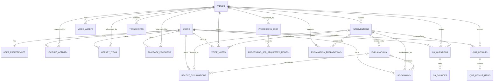

# Synapse Database Foundation and Final ERD

Status: Task 4 foundation, Task 5 shared processing coordination, and Task 6A local learning history. `users`, `user_preferences`, processing coordination, `lecture_activity`, `library_items`, `playback_progress`, and `recent_explanations` are implemented. All tables marked **planned** remain contracts for later tasks.

## Decisions and boundaries

- SQLite is the local database; SQLAlchemy models and named constraints remain PostgreSQL-compatible.
- `DATABASE_URL` selects the database. The default resolves to `synapse.db` at the repository root, independent of the process working directory.
- Alembic is the only application-schema upgrade mechanism. Runtime startup no longer calls `create_all`; tests may still use model metadata to create isolated fixtures.
- User IDs are UUIDs. Migration `20261024_0001` creates one stable local profile: `00000000-0000-4000-8000-000000000001`, profile key `local-development`.
- Authentication and authorization are deferred. The stable profile supplies ownership continuity, not a security boundary.
- Videos, transcripts, interventions, generated explanations, assets, and preparation state are shared cache data. Personal records carry `user_id` and never reuse shared flags as ownership.
- Audio, images, transcripts, snapshots, and voice recordings remain in managed file/object storage. Database rows store relative media keys, MIME types, sizes, hashes, and lifecycle state—not media bytes.
- Timestamps are UTC. New tables use timezone-aware SQLAlchemy timestamps; SQLite serializes them while PostgreSQL can use native timezone-aware columns.

## ERD



## Implemented schema

### `users`

| Column | Type | Rules |
|---|---|---|
| `id` | UUID | PK; generated UUID for future users |
| `profile_key` | varchar(64) | not null; unique `uq_users_profile_key`; stable non-secret application key |
| `display_name` | varchar(120) | not null |
| `is_local` | boolean | not null, default false |
| `created_at`, `updated_at` | timestamp with timezone | not null, server timestamps |

The migration seeds exactly one local row and is idempotent. No credentials, sessions, roles, tokens, or authorization fields exist in Task 4.

### `user_preferences`

| Column | Type | Rules |
|---|---|---|
| `user_id` | UUID | PK and FK `users.id`, `ON DELETE CASCADE` |
| `theme` | varchar(32) | `paper` or `dark`; default `paper` |
| `presentation_mode` | varchar(32) | `accessibility` or `study`; default `accessibility` |
| `explanation_mode` | varchar(32) | `brief`, `explanatory`, or `detailed`; default `explanatory` |
| `playback_rate` | float | 0.5–3.0; default 1.0 |
| `text_scale` | float | 0.75–2.0; default 1.0 |
| `high_contrast` | boolean | not null, default false |
| `reduced_motion` | nullable boolean | null means follow the operating-system preference |
| `locale` | varchar(16) | not null, default `en` |
| `created_at`, `updated_at` | timestamp with timezone | not null, server timestamps |

### Existing shared cache

| Table | Primary key | Foreign keys and uniqueness | Important indexes | Ownership / deletion |
|---|---|---|---|---|
| `videos` | YouTube `id` string | canonical `source_url`; no user FK | PK/`ix_videos_id` | Shared. Delete only through cache maintenance after dependent/personal-reference checks. |
| `transcripts` | integer `id` | `video_id -> videos.id` | `video_id`, `start_time` | Shared. Target rule is cascade with video; legacy FK currently has no database cascade. |
| `interventions` | UUID string `id` | `video_id -> videos.id` | `video_id`, `timestamp`, legacy `is_bookmarked` | Shared. `is_bookmarked` is legacy compatibility state and must not become the personal bookmark source of truth. |
| `explanations` | integer `id` | `intervention_id -> interventions.id`; target unique `(intervention_id, output_mode)` | `intervention_id` | Shared generated cache. Media columns are paths only. Duplicate legacy modes must be audited before adding the target unique constraint. |
| `explanation_preparations` | integer `id` | FKs to video and intervention; unique `(video_id, intervention_id, output_mode)`; checks for mode/status | `video_id`, `intervention_id`, `output_mode`, `status` | Shared job state. Retain while intervention exists; failed states retain sanitized error code and attempt count. |
| `processing_jobs` | UUID `id` | unique `video_id`; checks for status, stage, and requested output mode | `status`, `stage` | Shared coordination row retained across retries. It intentionally has no video FK because the row exists before a video cache record. Safe errors and leases support restart recovery. |
| `processing_job_requested_modes` | (`job_id`, `output_mode`) | `job_id -> processing_jobs.id ON DELETE CASCADE`; mode check | composite PK | Durable set of every mode requested by callers sharing a job. Retained with the job and backfilled from the Task 5A compatibility column. |

The foundation migration creates any missing legacy shared table, including `explanation_preparations`, but detects and preserves tables already present. It never rebuilds an existing SQLite table.

### Processing-job API contract

- `POST /video/processing-jobs` accepts the existing `{youtube_url, output_mode}` body. It returns HTTP 202 for queued/running work or HTTP 200 when a valid shared cache is reused. Concurrent callers receive the same `job_id` and `joined_existing=true` where applicable.
- `GET /video/processing-jobs/{job_id}` returns the persisted status and current real stage.
- `POST /video/processing-jobs/{job_id}/retry` restarts failed or stale work, joins active work, or returns the valid completed cache.
- `POST /video/process` retains its synchronous `ProcessVideoResponse` contract. Internally it creates or joins the durable job and waits for the shared result.

Job responses contain `job_id`, `video_id`, `status`, `stage`, `attempt_count`, `requested_modes`, cache/join indicators, sanitized error fields, and timestamps. They intentionally do not contain a progress percentage because the current detector does not expose measured sub-stage progress.

## Implemented personal learning history (Task 6A)

All UUID PKs below are backend-generated. Every personal table has a required `user_id -> users.id ON DELETE CASCADE` and an index beginning with `user_id`.

### Personal learning records

| Table | Core columns | Constraints and indexes | Retention / deletion |
|---|---|---|---|
| `lecture_activity` | `id` UUID PK, `user_id`, `video_id`, `first_opened_at`, `last_opened_at`, `open_count`, `last_intervention_id` nullable | unique `(user_id, video_id)`; indexes `(user_id,last_opened_at)`, `video_id`; video FK cascade, intervention FK set null | Ordinary activity older than 30 days is removed on history access. Shared cache is untouched. |
| `library_items` | `id` UUID PK, `user_id`, `video_id`, `added_at`, `last_accessed_at`, `preferred_mode` | unique `(user_id, video_id)`; index `(user_id,last_accessed_at)` | User-owned; cascade with user or deleted video. |
| `playback_progress` | `id` UUID PK, `user_id`, `video_id`, `position_seconds`, `duration_seconds`, `completed`, `updated_at` | unique `(user_id, video_id)`; check non-negative positions; index `(user_id,updated_at)` | User-owned; replace on update; cascade with user/video. |
| `recent_explanations` | `id` UUID PK, `user_id`, `video_id`, `intervention_id`, `explanation_id` nullable, `output_mode`, `viewed_at` | unique `(user_id,explanation_id)`; indexes `(user_id,viewed_at)` and `(user_id,video_id)`; intervention cascade, explanation set null | Rolling 30-day history; deleting history does not delete shared explanations or MP3 files. |

Personal APIs are rooted at `/me`, resolve the backend-controlled `local-development` profile, reject client-provided user IDs, and are unavailable when `SYNAPSE_ENV` is not a local/development/test environment. Mutation endpoints retain the existing allowed-origin check.

- Recent lectures: `GET /me/lectures/recent`, `PUT /me/lectures/{video_id}/opened`, and `DELETE /me/lectures/{video_id}/recent`.
- Library: `GET /me/library`, `PUT /me/library/{video_id}`, and `DELETE /me/library/{video_id}`.
- Playback: `GET`, `PUT`, and `DELETE /me/playback/{video_id}`. The PUT also maintains lecture activity's last intervention.
- Recent explanations: `GET /me/explanations/recent`, `PUT /me/explanations/{explanation_id}/viewed`, and `DELETE /me/explanations/recent/{history_id}`.

## Planned schema contracts

All UUID PKs below are backend-generated. Every personal table has a required `user_id -> users.id ON DELETE CASCADE` and an index beginning with `user_id`.

### Remaining personal learning records

| Table | Core columns | Constraints and indexes | Retention / deletion |
|---|---|---|---|
| `bookmarks` | `id` UUID PK, `user_id`, `video_id`, `intervention_id`, `explanation_id` nullable, `output_mode`, `created_at`, `note` nullable | unique `(user_id,intervention_id,output_mode)`; index `(user_id,created_at)` | Durable until user removes it; cascade with user/intervention, explanation set null. |

### Q&A and sources

| Table | Core columns | Constraints and indexes | Retention / deletion |
|---|---|---|---|
| `qa_questions` | `id` UUID PK, `user_id`, `video_id`, `intervention_id` nullable, `question_text`, `answer_text`, `status`, `scope`, `current_time_seconds` nullable, `provider_model` nullable, `created_at` | checks for known status/scope; indexes `(user_id,created_at)`, `(user_id,video_id,created_at)` | Default one year, configurable; cascade with user/video, intervention set null. No prompts/provider secrets. |
| `qa_sources` | `id` UUID PK, `question_id`, `ordinal`, `start_seconds`, `end_seconds`, `intervention_id` nullable | unique `(question_id,ordinal)`; ordered-time check; index `question_id`; question cascade, intervention set null | Cascades with the Q&A record. Stores citations, not transcript copies. |

### Completed quizzes

| Table | Core columns | Constraints and indexes | Retention / deletion |
|---|---|---|---|
| `quiz_results` | `id` UUID PK, `user_id`, `video_id`, `quiz_type`, `score`, `max_score`, `completed_at`, `settings_json` | score checks; indexes `(user_id,completed_at)`, `(user_id,video_id)` | Durable learning record until user deletion; cascade with user/video. Only completed attempts are persisted. |
| `quiz_result_items` | `id` UUID PK, `quiz_result_id`, `ordinal`, `question_text`, `question_type`, `selected_answer`, `correct_answer`, `is_correct`, `explanation_text`, `source_start_seconds`, `source_end_seconds` | unique `(quiz_result_id,ordinal)`; result cascade | Cascades with completed result. Snapshot preserves what was graded without depending on regenerated questions. |

### Voice notes

| Table | Core columns | Constraints and indexes | Retention / deletion |
|---|---|---|---|
| `voice_notes` | `id` UUID PK, `user_id`, `video_id`, `intervention_id` nullable, `lecture_seconds`, `label`, `media_key`, `mime_type`, `size_bytes`, `duration_ms`, `transcript_text` nullable, `created_at`, `updated_at` | checks for non-negative bounded time/size; indexes `(user_id,video_id,lecture_seconds)`, `(user_id,created_at)` | User-owned until explicit deletion/user deletion. Transactional outbox or reconciliation must remove the external media object; DB never stores the blob. |

### Shared processing and assets

| Table | Core columns | Constraints and indexes | Retention / deletion |
|---|---|---|---|
| `video_assets` | `id` UUID PK, `video_id`, `asset_type`, `storage_key`, `mime_type`, `size_bytes`, `sha256`, `created_at` | unique `(video_id,asset_type,storage_key)`; indexes `video_id`, `sha256` | Shared media manifest. Cascade with video and delete external object through a lifecycle worker. |

## Ownership, indexes, and deletion policy

1. Shared tables have no `user_id`. Processing a lecture once benefits every local/future authenticated user.
2. Personal rows always reference `users`; application queries must filter by the active user even before authentication exists.
3. User deletion cascades preferences and all personal data. It does not delete shared video or generated explanation cache.
4. Shared video deletion is an explicit cache-maintenance operation. Future migrations should use cascades for dependent shared rows and personal video references, paired with media cleanup.
5. Frequently rendered lists use composite ownership/time indexes. Unique constraints prevent duplicate library, progress, bookmark, preparation, and per-result item records.
6. SQLite foreign keys are enabled on every SQLAlchemy connection. PostgreSQL uses native enforcement.

## Migration and deployment procedure

```powershell
# Uses DATABASE_URL from .env/environment, or the repository-root SQLite default.
.\synapse-env\Scripts\python.exe -m alembic upgrade head

# Equivalent setup/verification helper:
.\synapse-env\Scripts\python.exe -m api.setup
```

Revision `20261024_0001` is the additive legacy-aware foundation. Revision `20261024_0002` adds `processing_jobs` without rebuilding shared cache tables. Revision `20261024_0003` adds the requested-mode registry and backfills every existing job's compatibility mode. Revision `20261024_0004` adds the four Task 6A personal-history tables without changing shared cache tables. On an existing database all revisions leave shared cache rows untouched, and repeated `upgrade head` calls are no-ops. Downgrades are deliberately blocked because these migrations must not delete user, job, or legacy data.

For PostgreSQL, set a `postgresql+psycopg://` URL, provision the empty database, and run the same upgrade command. Do not point two independently starting application processes at an unmigrated database; migrations are a deployment step.

## Remaining risks and future migration gates

- Legacy SQLite foreign keys exist but lack the target cascade rules; changing them requires a separately tested batch migration because SQLite rebuilds tables.
- `interventions.is_bookmarked` is shared legacy state. It must remain compatibility-only until personal `bookmarks` ships and data is reconciled.
- Existing explanation rows must be checked for duplicate `(intervention_id, output_mode)` values before enforcing the planned unique constraint.
- File deletion is not transactional with SQL. Asset and voice-note APIs need a reconciliation/outbox strategy before personal media is implemented.
- The local profile is identity continuity only. No endpoint may treat its UUID as authorization once remote access or multiple users are introduced.
- Task 6A retention is enforced lazily when recent lecture or explanation history is read. A future scheduled maintenance worker may enforce the same 30-day policy without requiring API access.
- Terminal processing-job retention cleanup is not implemented yet; Task 5A keeps job history so retry and recovery evidence remains durable.
